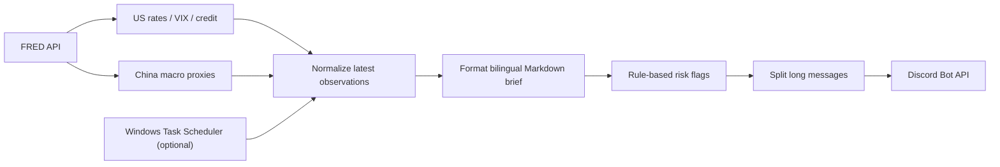

<div align="center">
  
  <h1>Macro Bot 📡</h1>
  <p><strong>From economic data to a concise Discord briefing.</strong></p>
  <p>A Python automation experiment that gathers US and China macroeconomic indicators, summarizes risk context with transparent rules, and delivers the result to a Discord channel.</p>
  <p>   </p>
  <p><a href="#how-it-works">How it works</a> · <a href="#run-locally">Quick start</a> · <a href="#data-coverage">Data coverage</a></p>
</div>

> **Visual note:** Macro Bot has **no web interface**. The image above illustrates its real code modules and information flow; it is not a screenshot, live macro report, or evidence that a Discord channel is connected.

## The problem

Checking the same market indicators across multiple sources is repetitive. This project automates the *collection and formatting* stage: fetch a short list of important US and Chinese indicators, put them into a readable comparison, flag a few conditions worth noticing, and post the brief where it can be read quickly.

The goal is a **transparent, repeatable information pipeline**—not an automated trading system or a machine-learning forecasting service.

## How it works



| Stage | Implementation | File |
| --- | --- | --- |
| Fetch US indicators | Requests latest FRED observations for yields, real rates, VIX and credit spreads | [\`fetch_us_macro.py\`](fetch_us_macro.py) |
| Fetch China indicators | Requests FRED country-series proxies, tolerating missing observations | [\`fetch_cn_macro.py\`](fetch_cn_macro.py) |
| Compose brief | Aligns observed values and dates in a Markdown comparison; applies simple thresholds | [\`make_macro_brief.py\`](make_macro_brief.py) |
| Deliver message | Calls Discord's messages endpoint, splitting output into chunks of up to 1,900 characters | [\`run_and_send_brief.py\`](run_and_send_brief.py) |
| Optional scheduling | Windows batch entry point suitable for Task Scheduler | [\`runner.cmd\`](runner.cmd) |

## What the output looks like

This is a **format illustration** based on the actual brief template, deliberately using *placeholders rather than invented market values*.

```text
📌 宏观简报（US vs CN） | asof: [source observation time]

利率 / 利差（对齐）
- 10Y 国债收益率 | US: [latest %] | CN: NA
- 10Y-2Y 期限利差 | US: [spread] | CN: NA
- CN 3M 同业利率（占位） | US: NA | CN: NA

通胀 / 活动（对齐）
- CPI YoY | US: NA | CN: [latest %]
- 工业生产指数 | US: NA | CN: [latest index]

信用 / 风险（对齐）
- HY OAS | US: [latest %] | CN: NA
- VIX | US: [latest value] | CN: NA

风险提示（粗）
- [Rule-triggered contextual flag, if applicable]
```

The underlying script builds a *text-only Discord post*, not a visual report. Values come from the API at runtime and may be unavailable.

## Data coverage

| Market | Indicators | Data source |
| --- | --- | --- |
| United States | Treasury 2Y/10Y, 10Y real yields, high-yield OAS, VIX and a 10Y–2Y curve spread | FRED |
| China | CPI year-on-year, USD/CNY, industrial production and private credit/GDP proxies | FRED |

**Caveats:** Coverage is asymmetric because there is no one-to-one series for every concept in both countries. The China 3M interbank field is a **placeholder**; some FRED series can be unavailable, delayed or discontinued. The brief prints \`NA\` where appropriate rather than inventing replacements. Each series has its own observation date and publication lag.

## Engineering highlights

The implementation uses basic but useful production concepts: isolating API fetchers, safe handling of missing observations, subprocess output capture with UTF-8 decoding, structured logs and explicit HTTP failure handling. The Discord sender chunks long messages below the platform's 2,000-character limit. The Windows runner records invocation times and exit codes.

Risk flags—for example, a low VIX, narrow high-yield spreads, an inverted yield curve or low Chinese CPI—are **hard-coded, qualitative heuristics**. They are not generated by an LLM and should not be interpreted as investment signals.

## Run locally

**Requirements:** Python 3.9+, internet access, a valid [FRED API key](https://fred.stlouisfed.org/docs/api/api_key.html), and optionally a Discord bot authorized to post in a channel.

```bash
git clone https://github.com/Roxyh-code/Macro_Bot.git
cd Macro_Bot
python -m pip install -r requirements.txt
```

Create a **local file named \`.env\`** (the repository currently does *not* include an \`.env.example\` file):

```dotenv
FRED_API_KEY=your_private_fred_key
DISCORD_BOT_TOKEN=your_private_discord_bot_token
DISCORD_CHANNEL_ID=your_discord_channel_id
```

Run the individual fetchers or print the brief without sending it:

```bash
python fetch_us_macro.py
python fetch_cn_macro.py
python make_macro_brief.py
```

To deliver the full brief to the configured Discord channel:

```bash
python run_and_send_brief.py
```

On Windows, \`runner.cmd\` can be added manually to Task Scheduler. **A scheduler isn't provisioned by this repository.**

### Security & operational notes

- Never commit \`.env\`, Discord bot tokens, FRED API keys or execution logs.
- The Discord bot needs permission to send messages in the target channel.
- Fetching requires connectivity and may fail because of invalid credentials, rate limits or provider outages.
- The automation **does not** trade, place orders, predict returns or guarantee delivery.

## Repository guide

```text
Macro_Bot/
├── fetch_us_macro.py          # US FRED series
├── fetch_cn_macro.py          # China FRED macro proxies
├── make_macro_brief.py        # Normalization and text brief
├── run_and_send_brief.py      # Discord delivery, chunking, logs
├── send_discord.py            # Connectivity test
├── check_cn_series.py        # China series diagnostics
├── config.py                  # Local env loader
├── runner.cmd                 # Optional Windows scheduler wrapper
└── docs/assets/              # Documentation architecture illustration
```

---

**Why this project matters:** An intentionally small automation example connecting **data retrieval → interpretation rules → message delivery** with clear boundaries between source facts and simple heuristics.
